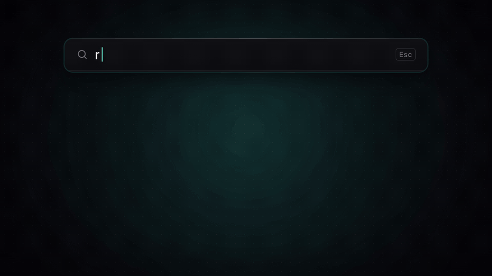
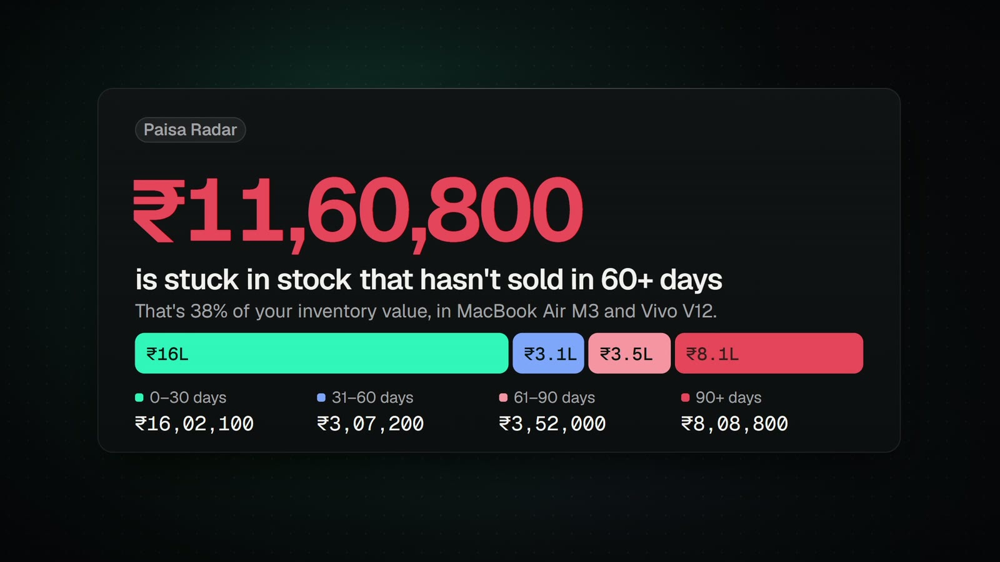
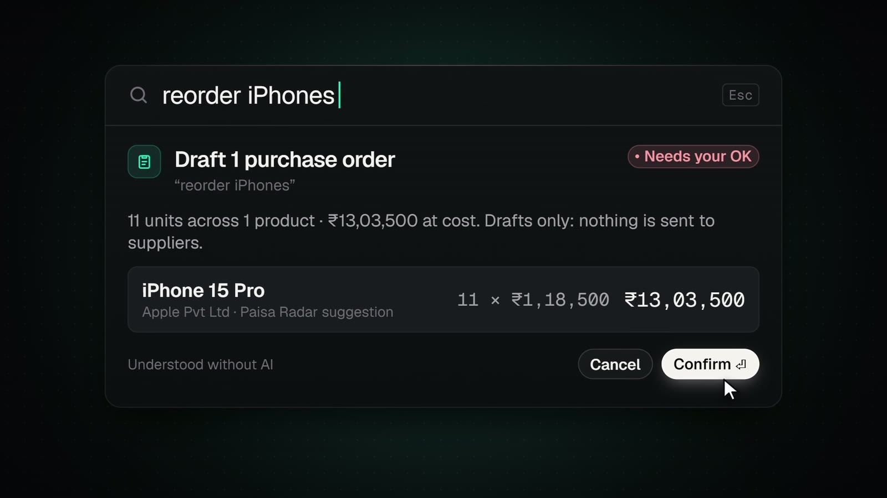
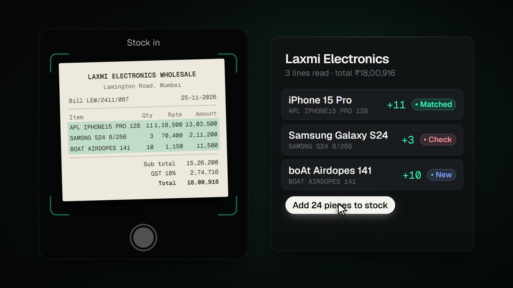
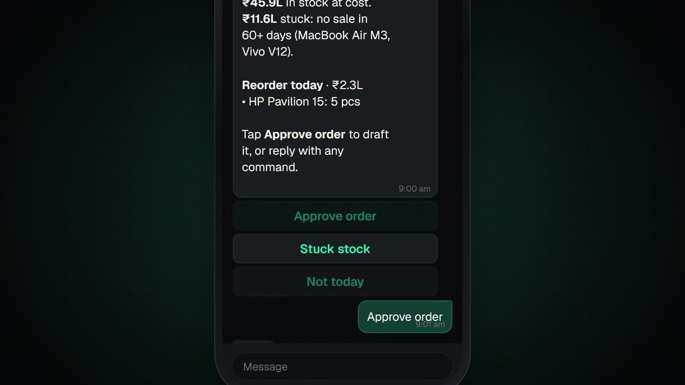
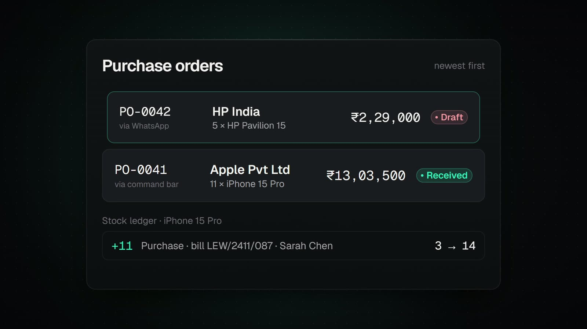

<div align="center">


**Inventory for Indian shops, counted in rupees.**

[Open the live demo](https://stockwaves.netlify.app) &nbsp;·&nbsp;
[Watch the 69-second film](https://stockwaves.netlify.app/film/stockwaves-film.mp4) &nbsp;·&nbsp;
[API reference](https://api-production-7190a400.up.railway.app/docs)

</div>

---

Most inventory software counts pieces. A shop owner thinks in money: how much is sitting on the shelf, what isn't
selling, what will run out before the supplier can deliver. StockWaves answers those questions in rupees, drafts the
order, reads the supplier's bill from a photo, and sends the morning's numbers to the owner on WhatsApp.

You can run the whole shop by typing a sentence, in English or Hinglish. Every change shows a preview first, waits
for your OK, and can be undone.

<div align="center">
  
</div>

## What it does

### Paisa Radar: where the money is stuck



The Today screen opens with the one number that matters most. In the demo shop that's **₹11,60,800** of stock that
hasn't sold in 60 days, which is 38% of the shelf. Stock is grouped by how long ago each product last sold, valued at
what you paid for it. Below it sits a short list of what to do first, ranked by the rupees at stake: a short discount,
a bundle, a return to the supplier, or an order for what's about to run out. Tap any figure to see how it was worked out.

### Type what you want done



Press <kbd>Ctrl</kbd> <kbd>K</kbd> anywhere and type the way you'd tell your staff:

```text
reorder iPhones                        order 10 Galaxy S24 from Samsung
20 USB-C Hub aaye                      sold 2 Galaxy S24
set price of iPad Air 5 to 61900       set stock of Vivo V12 to 18
kya khatam hone wala hai?              what didn't sell this month?
```

Each command becomes a preview of exactly what will change: the purchase order with its lines and total, the stock
going from 45 to 65, the new margin after a price change. Nothing happens until you confirm. Done actions get an
**Undo**, and every command is kept in an action log with who ran it. Everyday commands are understood by plain rules
and need no AI. With an AI key the app also understands your own wording and open questions.

### Snap-a-Bill: the supplier's bill becomes stock



Photograph the paper bill. StockWaves reads each line and matches it to your products even when the supplier spells
them their own way (`APL IPHONE15 PRO 128` is your iPhone 15 Pro). Close matches ask you to check, and items you don't
stock yet are offered as new products. It remembers how each supplier writes their items, so the next bill matches by
itself. One press adds the whole bill to stock, with one ledger entry per product linked to the bill.

### The 9 am WhatsApp brief



Every morning, each person who opts in gets the shop's numbers on WhatsApp: stock value, what runs out before the next
delivery, what's stuck, and the order to place. **Approve order** drafts the purchase order in one tap. If the
numbers changed since the brief went out, it shows the new order and asks again instead of running it. Any reply is a
command (`2 Galaxy S24 beche`, `undo`, `stop`), and the brief can come in English or Hinglish. Until a WhatsApp number
is connected, the WhatsApp page has a phone preview that works exactly the same way.

### Purchase orders and a stock ledger you can trust



Purchase orders go from draft to sent to received; receiving one adds the stock and updates the cost price. Stock only
ever changes through the ledger (sales, bills, returns, corrections), so every unit has a history of who changed it,
when, and why. Owners, managers and staff get different permissions: staff can record sales but can't change prices
or draft orders.

Also included: an analytics dashboard, products with price tiers, categories, suppliers with lead times, a team list,
and Excel/CSV import.

## Try the demo

The demo is a sample electronics shop with five months of sales. On the
[landing page](https://stockwaves.netlify.app), **Open the demo shop** signs you straight in, or use one of these:

| Role | Email | Password | Can do |
|------|-------|----------|--------|
| Owner | `admin@sam.com` | `admin123` | Everything, including the team and WhatsApp settings |
| Manager | `manager@sam.com` | `pass123` | Stock, purchase orders, prices and supplier bills |
| Staff | `staff@sam.com` | `pass123` | Sales and looking up stock |

The demo is shared, so other visitors may have changed things. Every action can be undone.

## How the numbers are worked out

Paisa Radar is plain arithmetic on your sales and the stock ledger, with no AI involved, so every figure can be
explained.

| Figure | Rule |
|--------|------|
| Selling rate | Units sold in the last 30 days ÷ 30 |
| Stuck stock | In stock, with no sale for 60 days or more |
| Slow stock | More than 26 weeks of stock at the current selling rate |
| Reorder point | Selling rate × (supplier's lead time + 3 days of safety) |
| Suggested order | Selling rate × (lead time + 21 days) − stock on hand, rounded up |
| Sales at risk | Units you'd run short of before a delivery placed today arrives × selling price |
| Stock value | Quantity × cost price, not selling price |

## Run it locally

You need Python 3.12 and Node 20.

```bash
git clone https://github.com/Saksham653/inventory-management-system.git
cd inventory-management-system

# API on http://localhost:8000 (SQLite and the demo shop by default)
python -m venv venv
source venv/bin/activate            # Windows: venv\Scripts\activate
pip install -r requirements.txt
cp .env.example .env
uvicorn main:app --reload --port 8000

# App on http://localhost:5173 (proxies /api to the API)
cd frontend
npm install
npm run dev
```

## Deploy

The live app runs on two services, and both redeploy on every push to `main`:

| Part | Host | How |
|------|------|-----|
| API and database | Railway (Singapore) | Builds the `Dockerfile`; PostgreSQL in the same project |
| Web app and landing page | Netlify | Builds `frontend/` per `netlify.toml`, which proxies `/api/*` to Railway |

**Railway.** Create a project with a PostgreSQL database and a service from this repo, then set:

| Variable | What it's for |
|----------|---------------|
| `DATABASE_URL` | `${{Postgres.DATABASE_URL}}` |
| `SECRET_KEY` | Signs logins. Without it everyone is signed out on each restart |
| `SEED_DEMO` | `true` for the demo shop and logins, `false` for a real shop |
| `ADMIN_EMAIL`, `ADMIN_PASSWORD` | Optional first admin, created when there are no users |
| `FRONTEND_URL` | Your Netlify address |
| `GROQ_API_KEY` or `ANTHROPIC_API_KEY` | Optional: free-form commands and bill photos |
| `WHATSAPP_*` | Optional: the WhatsApp brief (below) |

Tables are created and upgraded on startup. `GET /api/v1/health` answers once the API can reach the database.

**Netlify.** Point the `/api/*` redirect in `netlify.toml` at your Railway domain and import the repo. The build
settings come from `netlify.toml`.

## WhatsApp setup

1. On [developers.facebook.com](https://developers.facebook.com), create an app, add the WhatsApp product and a
   business number. The free test number can message up to five phones.
2. Set these on Railway:

   | Variable | Value |
   |----------|-------|
   | `WHATSAPP_TOKEN` | A permanent token of a system user with `whatsapp_business_messaging` |
   | `WHATSAPP_PHONE_NUMBER_ID` | The number's id from WhatsApp → API Setup |
   | `WHATSAPP_APP_SECRET` | App settings → Basic. Webhooks without a valid signature are rejected |
   | `WHATSAPP_VERIFY_TOKEN` | Any phrase; enter the same one in Meta |
   | `WHATSAPP_BRIEF_TEMPLATE` | Optional: the approved template below |

3. In Meta → WhatsApp → Configuration, set the callback URL to
   `https://<your-railway-domain>/api/v1/whatsapp/webhook` (the WhatsApp page shows it with a copy button), enter the
   verify token and subscribe to `messages`.
4. Turn the brief on and add numbers on the WhatsApp page. Each person sends "hi" to the shop number once.

WhatsApp lets a business send free-form messages only within 24 hours of the person's last message. For the other
mornings, create a **Utility** template (for example `daily_brief`) with two quick-reply buttons, **Show brief** and
**Approve order**, and this body:

```text
Good morning. Your StockWaves brief for {{1}}:
Stock at cost: {{2}}
Running out: {{3}}
Stuck 60+ days: {{4}}
Tap below to see the full brief or approve the reorder.
```

## API

Every endpoint is documented at [`/docs`](https://api-production-7190a400.up.railway.app/docs). All of them need
`Authorization: Bearer <token>` except login, refresh, health and the signed WhatsApp webhook. The main ones:

| Method | Endpoint | Who | What |
|--------|----------|-----|------|
| `POST` | `/api/v1/auth/login` | Anyone | Sign in: access and refresh tokens |
| `GET` | `/api/v1/radar/` | Signed in | Paisa Radar: stuck cash, reorder list, ranked actions |
| `POST` | `/api/v1/assistant/plan` | Signed in | Understand a command and return its preview |
| `POST` | `/api/v1/assistant/actions/{id}/execute` | Signed in* | Run a previewed command |
| `POST` | `/api/v1/assistant/actions/{id}/undo` | Signed in* | Undo it |
| `POST` | `/api/v1/bills/scan` | Manager | Read a bill photo into a draft with matched lines |
| `POST` | `/api/v1/bills/{id}/post` | Manager | Add the bill to stock |
| `POST` | `/api/v1/purchase-orders/draft-from-radar` | Manager | Draft orders from the reorder list |
| `POST` | `/api/v1/purchase-orders/{id}/receive` | Manager | Receive an order into stock |
| `POST` | `/api/v1/sales/` | Signed in | Record a sale (the server sets the price and moves stock) |
| `GET` | `/api/v1/stock/movements` | Signed in | The stock ledger |
| `PUT` | `/api/v1/whatsapp/settings` | Owner | Brief on or off, time, days, language |
| `POST` | `/api/v1/whatsapp/webhook` | Meta, signed | Incoming WhatsApp messages and delivery receipts |

\* Stock, order and price commands need a manager or the owner.

## Project layout

```text
main.py                  FastAPI app: routes, startup upgrades, serves the built frontend
app/
  api/                   one router per area (auth, products, radar, bills, assistant, whatsapp, ...)
  services/
    radar.py             Paisa Radar
    stock.py             the only code that changes stock (writes the ledger)
    commands.py          the command bar: rules, AI fallback, preview, execute, undo
    bill_reader.py       reads bill photos (Claude or Groq)
    matching.py          matches bill lines to products and learns supplier spellings
    whatsapp.py          the morning brief, replies, sending, the daily schedule
  core/                  settings, database, auth, schema upgrades, demo data
  models/schema.py       the database models
frontend/
  src/pages/             Today, Paisa Radar, Products, Stock in, Purchase orders, WhatsApp, Landing, ...
  src/components/        the shell, command palette and shared UI
  public/film/           the product film
Dockerfile               one image: builds the frontend, runs the API
netlify.toml             the Netlify build and the /api proxy
```

## Built with

FastAPI and SQLAlchemy 2 (async) on PostgreSQL in production and SQLite locally; JWT sign-in with bcrypt; React 18
with Vite and Recharts; Claude or Groq for bill photos and free-form commands; the WhatsApp Cloud API; Remotion for
the product film.

## Credits

- Film music: "Coffee or Tea" by Michael Ramir C., [Mixkit Stock Music Free License](https://mixkit.co/license/#musicFree).
  Sound effects from Mixkit under its free licence.
- Type: [Geist and Geist Mono](https://vercel.com/font) and [Anek Latin](https://github.com/EkType/Anek) by Ek Type,
  all under the SIL Open Font License.

---

<div align="center">

Built by [Saksham Srivastava](https://github.com/Saksham653)

</div>
